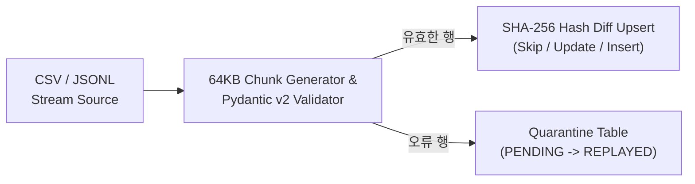

# ingestguard

대용량 CSV 및 JSONL 배치 데이터를 적재할 때 일부 행의 스키마 오류로 전체 트랜잭션이 롤백되거나, 재업로드 시 정상 행까지 중복 쓰기되는 문제를 막기 위한 Python 패키지 겸 FastAPI 서버입니다. 청크 단위 스트리밍 검증, `record_key` 기반 해시 비교 멱등 Upsert, 불량 행 격리(Quarantine)와 보정 재반영(Replay)을 제공합니다.

## 빠른 실행

### FastAPI 서버 실행 및 적재/재처리 API

```bash
# 기본 인메모리 SQLite 모드로 실행
python3 -m ingestguard.cli serve --host 0.0.0.0 --port 8000

# 파일 기반 SQLite 실행
python3 -m ingestguard.cli serve --db-url "sqlite:///ingest.db" --port 8000
```

| 메서드 | 경로 | 설명 |
|---|---|---|
| `POST` | `/v1/jobs/ingest` | CSV/JSONL 데이터 청크 스트리밍 적재 시작 |
| `GET` | `/v1/jobs/{job_id}` | 적재 작업 통계 및 상태(`COMPLETED`, `PARTIAL_QUARANTINE`) 조회 |
| `GET` | `/v1/jobs/{job_id}/quarantine` | 격리된 불량 행 목록 및 원본 페이로드 조회 |
| `POST` | `/v1/quarantine/{quarantine_id}/replay` | 보정된 페이로드 검증 후 본 테이블로 승격 반영 |
| `GET` | `/v1/datasets/{dataset}/records` | 적재된 정상 레코드 목록 조회 |
| `GET` | `/healthz` | 서비스 헬스체크 |
| `GET` | `/metrics` | Prometheus 메트릭 노출 |

### CLI 직접 실행

```bash
# 배치 적재 실행
python3 -m ingestguard.cli ingest \
  --dataset products \
  --format csv \
  --spec schema.json \
  --input data.csv \
  --db-url sqlite:///ingest.db

# 격리 행 보정 재반영
python3 -m ingestguard.cli replay \
  --id "quarantine-uuid" \
  --spec schema.json \
  --payload patch.json \
  --db-url sqlite:///ingest.db
```

## 적재 및 격리(Quarantine) 구조



1. **청크 스트리밍 검증**: `io.StringIO`와 `csv.DictReader` 제너레이터로 전체 파일을 메모리에 올리지 않고 `chunk_size` 단위로 읽어 `SchemaSpec` 기반 동적 모델(`pydantic.create_model`)로 통과 행(`ValidatedRow`)과 실패 행(`RejectedRow`)을 분리합니다.
2. **해시 비교 멱등 Upsert**: 정렬된 JSON의 SHA-256 해시를 비교해 `(dataset, record_key)` 복합 키 기준으로 기존 해시와 같으면 DB 쓰기를 건너뛰고(`skipped_rows`), 신규이거나 값이 바뀐 행만 `on_conflict_do_update`로 반영합니다.
3. **격리 및 재반영**: 스키마 검증에 실패한 행은 `QuarantineRow(status="PENDING")` 테이블에 행 번호와 오류 원인을 함께 저장합니다. 운영자가 수정한 페이로드를 전달하면 동일 스키마로 재검증한 뒤 본 테이블로 승격(`REPLAYED`)합니다.

## 모듈 구성

```text
ingestguard/
├── models.py      SQLAlchemy 2.0 JSON 컬럼 및 Pydantic v2 스키마 정의
├── parser.py      CSV 및 JSONL 청크 스트리밍 제너레이터 및 동적 모델 검증기
├── store.py       SQLAlchemy on_conflict_do_update 기반 멱등 저장소
├── replayer.py    배치 적재 오케스트레이션, 격리 행 재반영 및 prometheus-client 메트릭
├── app.py         FastAPI Lifespan HTTP 서버 (/v1/jobs, /quarantine, /metrics)
└── cli.py         Typer 기반 CLI 엔트리포인트 (serve, ingest, replay)
tests/
└── test_ingestguard.py   멱등 Upsert, 격리 전이, 동시성 경합 및 FastAPI E2E 검증
```

요구 환경은 Python 3.12 이상이며 `fastapi`, `pydantic>=2.7`, `sqlalchemy>=2.0`, `typer>=0.12`, `prometheus-client>=0.20`, `uvicorn`, `httpx`, `pytest`를 사용합니다.

## 테스트

```bash
python3 -m pytest -v
```

기본 저장소는 SQLite `on_conflict_do_update`를 사용하므로 다중 워커가 동시에 대량 쓰기를 수행하는 환경에서는 PostgreSQL 백엔드로 연결해야 잠금 대기가 줄어듭니다. 입력 포맷은 CSV와 JSONL 텍스트 스트림을 지원하며 `.xlsx`나 압축 파일은 사전 변환이 필요합니다.
